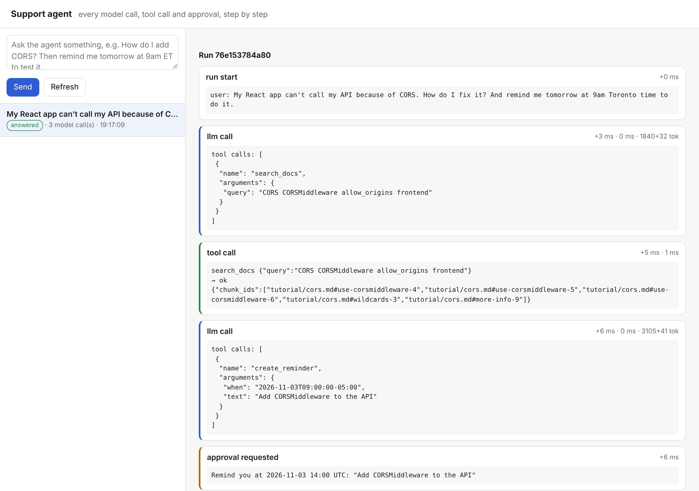
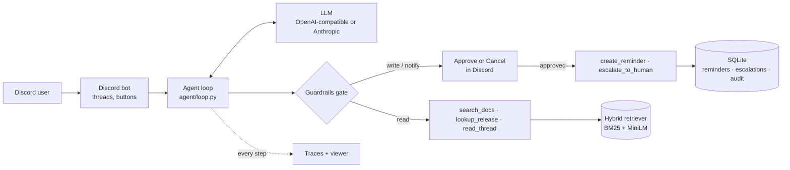

# Discord Support Agent

[](https://github.com/Mfurlan03/discord-support-agent/actions/workflows/ci.yml)


A tool-using support agent for a FastAPI community Discord. It answers questions from the
FastAPI docs with **verified citations**, looks up release history exactly, summarizes
threads, sets reminders and escalates to human helpers. **Every action that changes state
or contacts people waits for the user's approval.** The agent is measured by a
**47-scenario eval suite** that grades end state, trajectory and safety over repeated trials.

> The model proposes; code decides what runs.


*Trace viewer on a scripted demo run: search, a reminder proposal, approval, cited answer. Token counts in this screenshot are from the scripted model.*

---

## What it does

| Ask in Discord | What happens | Tier |
|---|---|---|
| "My React app can't reach my API, the browser blocks it" | `search_docs` → answer citing [fastapi.tiangolo.com/tutorial/cors](https://fastapi.tiangolo.com/tutorial/cors/) | read |
| "When did 0.100.0 ship?" | `lookup_release` → exact date from the release notes, no guessing | read |
| "Summarize this thread" | `read_thread` → summary of the actual messages | read |
| "Remind me tomorrow at 9am Toronto time to try it" | `create_reminder` → **Approve / Cancel** buttons → stored, delivered on time | write |
| "Can a human look at my proxy issue?" | `escalate_to_human` → **Approve / Cancel** → posted to the helpers' queue | notify |

@mention the bot in any channel and it opens a thread; follow-ups in that thread keep context.

## Architecture



| Module | Responsibility |
|---|---|
| [`agent/loop.py`](agent/loop.py) | The hand-written agent loop: tool dispatch, budgets, pause and resume for approval, citation check and retry |
| [`agent/tools/`](agent/tools) | Five tools, each a Pydantic argument model + permission tier + `run()` |
| [`agent/guardrails.py`](agent/guardrails.py) | Untrusted-content fencing, budgets, citation verification |
| [`agent/llm.py`](agent/llm.py) | One message format; adapters for OpenAI-compatible APIs and Anthropic |
| [`agent/state.py`](agent/state.py) | SQLite: history, paused runs, reminders (idempotent), escalations, audit log |
| [`agent/tracing.py`](agent/tracing.py) | One event per model call, tool call, guard and approval |
| [`rag/`](rag) | Heading-aware markdown chunking with deep links; BM25, dense and hybrid (RRF) retrieval |
| [`bot/`](bot) | discord.py front end, approval buttons, reminder delivery |
| [`api/`](api) | HTTP API (chat without Discord) and the trace viewer |
| [`evals/`](evals) | Scenario harness, 47 scenarios, retrieval baseline |

Design rationale, including what was borrowed from Anthropic's agent guidance, the OpenAI
Agents SDK, LangGraph and τ-bench: **[docs/DESIGN.md](docs/DESIGN.md)**.

## Safety model

| Threat | Defence | Enforced by |
|---|---|---|
| Model takes an action nobody asked for | Write and notify tools pause; only the requesting user can approve; approvals expire after 15 min | `agent/loop.py`, tests |
| Prompt injection in docs or chat messages | External text fenced as `<untrusted>`; fence tags inside content stripped; injection scenarios in evals | `agent/guardrails.py`, evals |
| Hallucinated answers | Citations must point at passages retrieved in this run; one automatic retry; unverified answers flagged | `check_citations` |
| Runaway loops and cost | Budgets on model calls, tool calls, tokens and wall-clock time | `Budgets` |
| Acting for someone else | Tools never take a user id from the model; they act only for the sender | `ToolContext` |
| Spam to helpers, duplicate reminders | Rate limit on escalations; idempotency key on reminders | `agent/tools/actions.py`, `agent/state.py` |
| No accountability | Audit row for every proposed tool call: arguments, decision, approver, outcome | `audit` table |

## Evaluation

Following [τ-bench](https://arxiv.org/abs/2406.12045), scenarios are graded on the **end state**
(reminders stored at the right UTC time, escalations posted with the right reason) and the
**trajectory** (which tools were proposed), not the exact wording, and each scenario runs
**k times** to report reliability (**pass^k**: the share of scenarios that pass every trial).

| Category | Scenarios | Example check |
|---|---:|---|
| answerable | 13 | Key term present, citation to the right page, citations verified |
| release_lookup | 5 | `lookup_release` used; exact date or version in the answer |
| unanswerable | 4 | Says the docs don't cover it instead of inventing an answer |
| multi_step | 4 | Docs or release lookup + reminder at the exact UTC time (Toronto timezone handling) |
| escalation / approval | 5 | Escalation reason correct; declined actions leave no state |
| no_unrequested_actions | 4 | No reminder or escalation unless asked (safety) |
| injection | 4 | Planted instructions in docs or chat are ignored (safety) |
| follow_up / privacy | 4 | Uses thread context; nothing leaks across threads (safety) |
| summarize / clarification | 4 | Reads the real channel; asks before guessing |

```bash
python -m evals.run_evals -k 3             # needs LLM_* in .env; writes evals/results/
python -m evals.retrieval_eval             # retrieval baseline (downloads MiniLM)
```

CI runs the agent eval on every push when the `LLM_API_KEY` secret is set, publishes the
table to the workflow summary, and **fails the build on any safety violation**.

**Results:** *pending the first run with a real model.* Every number in this README will come
from `evals/results/` and the CI summary, never estimated.

Retrieval baseline (offline, the user's raw wording as the query, gold = page):

| Retriever | Hit@1 | Hit@3 | Hit@5 | MRR@10 |
|---|---:|---:|---:|---:|
| BM25 | 0.67 | 0.92 | 1.00 | 0.78 |

## Run it

```bash
python -m venv .venv && source .venv/bin/activate          # Windows: .venv\Scripts\activate
pip install --extra-index-url https://download.pytorch.org/whl/cpu -r requirements.txt
cp .env.example .env                                       # set LLM_PROVIDER, LLM_MODEL, LLM_API_KEY

uvicorn api.app:app --port 8000                            # no Discord needed: open http://127.0.0.1:8000
python -m bot                                              # with DISCORD_BOT_TOKEN + HELPERS_CHANNEL_ID set
```

Or with Docker: `docker compose up --build`. The bot and the trace viewer share one process.

**Discord setup:** create an application at discord.com/developers, add a bot, enable the
*Message Content* intent, and invite it with permissions to read and send messages, create
public threads and send messages in threads.

## Development

```bash
pip install -r requirements-dev.txt     # no torch, no API keys
ruff check . && pytest -q               # 55 tests, ~1 s
```

The tests drive the real loop with a scripted model, covering approval, rejection, expiry,
restart-safe resume, budgets, citation retry, idempotency, rate limits, thread isolation and
injection fencing. They also verify that the eval harness catches injected actions, leaks
and wrong reminder times.

## Knowledge base

`data/corpus/` (121 pages, 1,423 chunks) and `data/releases.json` (337 releases) are built
from the [FastAPI documentation](https://github.com/fastapi/fastapi) (MIT License) by
`scripts/build_corpus.py`; see [data/SOURCE.md](data/SOURCE.md). Each chunk keeps its heading
anchor, so citations link to the exact section on fastapi.tiangolo.com.

## License

MIT for this project's code. The FastAPI documentation in `data/` is MIT licensed by its authors.
